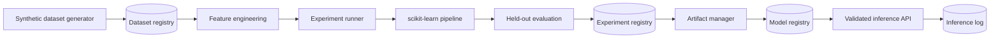

# EnergyML Research Platform

[](https://github.com/MehtaNandini/MehtaNandini.github.io/actions/workflows/energyml-ci.yml)

EnergyML is a reproducible machine-learning research platform for two energy-system problems:
hour-ahead renewable generation forecasting and noisy distribution-network voltage state
estimation. It generates meaningful synthetic research data, registers immutable dataset
metadata, trains and evaluates held-out models, versions artifacts, activates models, serves
validated inference, and records every prediction.

This is an independent 2026 portfolio project. It is an engineering research environment—not
a grid-control product and not a substitute for an AC power-flow simulator.

## Verified result

The committed [demo result](./docs/demo_results.json) was produced by
`scripts/run_full_demo.py` with seed 42; metrics are calculated from held-out test data and are
never hardcoded.

| Workflow | Model | Held-out result | Baseline / context |
|---|---|---:|---|
| Renewable forecast | HistGradientBoostingRegressor | MAE **2.950 MW**, RMSE **3.721 MW**, R² **0.779** | 38.0% lower MAE and 39.7% lower RMSE than 24-hour persistence |
| Five-bus state estimation | RandomForestRegressor, multi-output | MAE **0.000268 p.u.**, RMSE **0.000394 p.u.**, R² **0.9988** | Gaussian measurement noise σ = 0.005 |

High state-estimation accuracy is expected for the documented linearised synthetic network;
it must not be interpreted as performance on operational SCADA data.

## Research motivation

Energy experiments often become difficult to reproduce because the dataset seed, feature
window, split boundaries, model parameters, code version, and model binary drift apart.
EnergyML treats those values as a single traceable experiment. A prediction can be followed
back to a verified model hash, its completed experiment, a versioned dataset hash, and the
exact generation configuration.

## Architecture



FastAPI routers only validate and translate HTTP. Services own workflows, SQLAlchemy owns
metadata, experiment runners own lifecycle, ML modules own numerical logic, and
`ArtifactManager` owns all model/JSON/plot IO. CLI and dashboard clients call those same
services or APIs.

## Technology stack

Python 3.12, FastAPI, Pydantic, scikit-learn, Pandas, NumPy, SQLAlchemy 2, PostgreSQL,
SQLite, Alembic, Joblib, Matplotlib, Pytest, HTTPX, Docker Compose, Ruff, Black and Mypy.

## Repository structure

```text
energyml/
├── backend/
│   ├── app/
│   │   ├── api/                 # Dataset, experiment, model, inference and system routes
│   │   ├── datasets/            # Seeded renewable and network generators
│   │   ├── experiments/         # Shared lifecycle plus two specialised runners
│   │   ├── features/            # Leakage-safe time-series and state feature selection
│   │   ├── ml/                  # Pipelines, metrics and plotting
│   │   ├── models/              # SQLAlchemy registry entities
│   │   ├── schemas/             # Pydantic request/response contracts
│   │   ├── services/            # Registry, artifact, inference and statistics services
│   │   └── main.py
│   ├── alembic/                 # PostgreSQL/SQLite-compatible migration
│   └── tests/                   # Unit and end-to-end integration tests
├── scripts/                     # Dataset, training and complete demo CLIs
├── docs/demo_results.json       # Output of the verified seed-42 demo
├── Dockerfile
├── docker-compose.yml
├── Makefile
├── IMPLEMENTATION_PLAN.md
└── TASK.md
```

## Synthetic renewable dataset

The default dataset contains 8,760 hourly observations. Solar irradiance follows time of day,
season, cloud attenuation and weather variation. Temperature combines seasonal, daily and
weather effects. Wind and cloud series use temporally correlated processes. Generation is the
capacity-limited sum of temperature-adjusted photovoltaic output and a cubic wind-power curve,
plus controlled noise; the target is therefore not independent of its features.

Every dataset record contains ID, type, version, seed, generation parameters, row count,
creation time, CSV path and SHA-256 hash. The same seed and configuration produce equal data;
automated tests also prove that a different seed changes it.

## Forecasting workflow and leakage controls

Features include calendar/weather inputs; generation lags 1, 3, 6 and 24; and rolling means
3, 6 and 24. Rolling statistics are calculated from `target.shift(1)`, so the current and
future targets cannot enter a prediction row. Incomplete leading rows are removed. Data stays
ordered and is split 70% train, 15% validation and 15% final test by default. No global shuffle
is performed. The final fit uses train plus validation, while all reported quality is from the
untouched final test segment.

The saved scikit-learn pipeline contains median imputation, scaling and
`HistGradientBoostingRegressor`. Inference loads this same pipeline. A 24-hour persistence
forecast is evaluated on the identical test rows. Plots include actual vs predicted, two-week
time series, error distribution and seeded permutation importance.

## Voltage state-estimation workflow

Each sample describes a configurable radial network. Active and reactive loads follow global
load/generation factors and per-bus diversity. Target voltage magnitudes are computed from
cumulative downstream P/Q using simplified line resistance/reactance drops. Active/reactive
power, current, flow and selected voltage measurements receive configurable Gaussian noise.

This relationship is mathematically consistent for the simplified model but is not a full AC
power flow. `RandomForestRegressor` estimates all bus voltages directly as a multi-output
target. Evaluation reports aggregate and per-bus MAE/RMSE/R², true-vs-estimated voltage,
per-bus errors, error distribution and feature importance.

## Reproducibility and experiment tracking

- All randomness comes from local NumPy generators or estimators with an explicit recorded seed.
- Dataset versions derive from canonical generation configuration and CSVs carry SHA-256 hashes.
- Experiments record dataset ID/version, seed, model parameters, feature/split configuration,
  started/completed timestamps, status, code revision when available, metrics and performance.
- Performance metadata includes training duration, dataset/test rows, feature/target counts and
  model size.
- A failed runner changes `RUNNING` to `FAILED` and persists a concise error; it cannot register
  or activate a model.
- Tests verify equivalent repeated data and model predictions within numerical tolerance.

## Registries and artifact management

`datasets`, `experiments`, `models`, and `inference_runs` have foreign keys and query indexes.
Referenced datasets return HTTP 409 instead of being silently deleted. Only one model per task
can be active; activation happens transactionally and only completed experiments qualify.

Artifacts use `artifacts/<task>/<experiment-uuid>/` and contain:

```text
model.joblib             metrics.json
config.json              model_metadata.json
actual/true-vs-predicted plot
error distribution       feature importance
time-series or bus-error plot
```

Model bytes and every manifest item are SHA-256 checked. Paths are resolved under configured
roots, user-supplied artifact paths are rejected, and inference only deserialises artifacts
already registered by the platform.

## Quick start with SQLite

Python 3.12 is the supported runtime.

```bash
cd energyml
python3.12 -m venv backend/.venv
backend/.venv/bin/pip install -e 'backend[dev]'
cp .env.example backend/.env
make migrate
make run
```

Open [http://localhost:8000](http://localhost:8000) for the research dashboard or
[http://localhost:8000/docs](http://localhost:8000/docs) for OpenAPI.

## Docker and PostgreSQL

```bash
cd energyml
docker compose up --build
```

Compose waits for PostgreSQL, runs `alembic upgrade head`, starts EnergyML as an unprivileged
user, and exposes port 8000. Named volumes retain PostgreSQL metadata, datasets and artifacts
across restarts. `DATABASE_URL` uses SQLAlchemy's `postgresql+psycopg://` dialect. The Compose
password is explicitly local-only; production deployments must inject a secret.

To check persistence without deleting volumes:

```bash
docker compose restart
curl http://localhost:8000/api/stats
docker compose down             # keeps named volumes
```

## CLI experiments

All CLIs call application services and share the same registry/ML logic as the API.

```bash
backend/.venv/bin/python scripts/generate_renewable_dataset.py --days 365 --seed 42
backend/.venv/bin/python scripts/generate_state_dataset.py --buses 5 --samples 5000 --seed 42
backend/.venv/bin/python scripts/train_forecasting.py <dataset-id>
backend/.venv/bin/python scripts/train_state_estimation.py <dataset-id>
make demo
```

`make demo` generates both datasets, trains/evaluates both models, saves artifacts, registers
and activates them, performs sample inference, prints metrics, and refreshes
`docs/demo_results.json`.

## API

| Method | Endpoint | Purpose |
|---|---|---|
| GET | `/api/health`, `/api/stats` | Dependency health and platform counts |
| POST | `/api/datasets/generate/renewable` | Generate/register renewable CSV |
| POST | `/api/datasets/generate/state-estimation` | Generate/register network CSV |
| GET/DELETE | `/api/datasets`, `/api/datasets/{id}` | List, inspect or safely delete |
| POST | `/api/experiments/forecasting` | Train/evaluate/register gradient boosting |
| POST | `/api/experiments/state-estimation` | Train/evaluate/register random forest |
| GET | `/api/experiments/compare?ids=...&ids=...` | Compare configuration and metrics |
| GET | `/api/experiments/{id}/metrics` | Held-out metrics |
| GET | `/api/experiments/{id}/artifacts` | Safe hashed manifest |
| GET | `/api/models` | Model registry |
| POST | `/api/models/{id}/activate` | Select the active task model |
| POST | `/api/inference/forecast` | Forecast with active or explicit model |
| POST | `/api/inference/state-estimation` | Estimate bus voltages |

Generate and train:

```bash
curl -X POST http://localhost:8000/api/datasets/generate/renewable \
  -H 'Content-Type: application/json' \
  -d '{"number_of_days":365,"random_seed":42,"solar_capacity_mw":60,"wind_capacity_mw":40}'

curl -X POST http://localhost:8000/api/experiments/forecasting \
  -H 'Content-Type: application/json' \
  -d '{
    "dataset_id":"<dataset-id>",
    "random_seed":42,
    "model":{"type":"HistGradientBoostingRegressor","learning_rate":0.08,"max_iter":250,"max_depth":8},
    "split":{"train":0.7,"validation":0.15,"test":0.15}
  }'
```

Forecasting inference:

```bash
curl -X POST http://localhost:8000/api/inference/forecast \
  -H 'Content-Type: application/json' \
  -d '{
    "solar_irradiance":620.5,"temperature_c":23.4,"wind_speed_mps":7.2,
    "humidity_percent":58,"cloud_cover_percent":25,"hour":14,"day_of_week":2,
    "month":6,"day_of_year":165,"generation_lag_1":48.2,"generation_lag_3":44.9,
    "generation_lag_6":36.1,"generation_lag_24":51.7,"generation_rolling_mean_3":46.5,
    "generation_rolling_mean_6":42.8,"generation_rolling_mean_24":39.2
  }'
```

State inference accepts exactly the measurement keys recorded by the selected model. Inspect
`GET /api/models/{id}` for `feature_names_json`; a missing or extra key returns a useful 400.

## Validation, errors and security

Pydantic rejects missing fields, extras, NaN/infinity, invalid ranges and oversized requests.
The state service enforces exact feature dimensions. Unknown models/datasets return 404,
referenced deletions return 409, corrupt/missing artifacts fail closed, and internal stack
traces are not returned. Structured logs include request/experiment/dataset/model context but
never full datasets, model objects or raw inference bodies.

## Quality checks

```bash
make lint       # Ruff + Black validation
make typecheck  # strict Mypy
make test       # unit + integration suite
docker build -t energyml .
```

Tests cover reproducibility, different seeds, required columns, leakage prevention,
chronological splitting, metrics, persistence baseline, deterministic training, multi-output
prediction, per-bus metrics, artifact hashing/loading/corruption, database registration,
activation, protected deletion, failed experiments, health/comparison/validation, and both
complete generate → train → activate → infer workflows. GitHub Actions repeats all gates and
then starts the Docker Compose stack with PostgreSQL, trains/activates both models through HTTP,
restarts the app container, and proves database metadata and model artifacts persist by running
both inference APIs again.

## Configuration

| Variable | Default | Meaning |
|---|---|---|
| `DATABASE_URL` | `sqlite:///./energyml.db` | SQLite or PostgreSQL SQLAlchemy URL |
| `ARTIFACT_DIR` | `../artifacts` | Root-constrained model/plot storage |
| `DATASET_DIR` | `../datasets` | Root-constrained generated CSV storage |
| `DEFAULT_RANDOM_SEED` | `42` | Default deterministic seed |
| `LOG_LEVEL` | `INFO` | Structured log level |
| `API_HOST`, `API_PORT` | `0.0.0.0`, `8000` | Uvicorn binding |
| `ENVIRONMENT` | `development` | `development`, `test`, or `production` |

## Limitations and future work

- Synthetic signals are designed for reproducible method development, not operational claims.
- The voltage model is linearised; integrate pandapower for AC/DC power-flow scenarios.
- Training is synchronous, appropriate for this portfolio-scale platform; production should
  use a queue and worker pool.
- Filesystem artifacts are local; introduce S3-compatible object storage for distributed use.
- Future runners can add SCADA/smart-meter/weather sources, probabilistic/load forecasting,
  batteries, XGBoost/LightGBM, anomaly detection, hyperparameter search and MLflow without
  changing the registry contracts.
